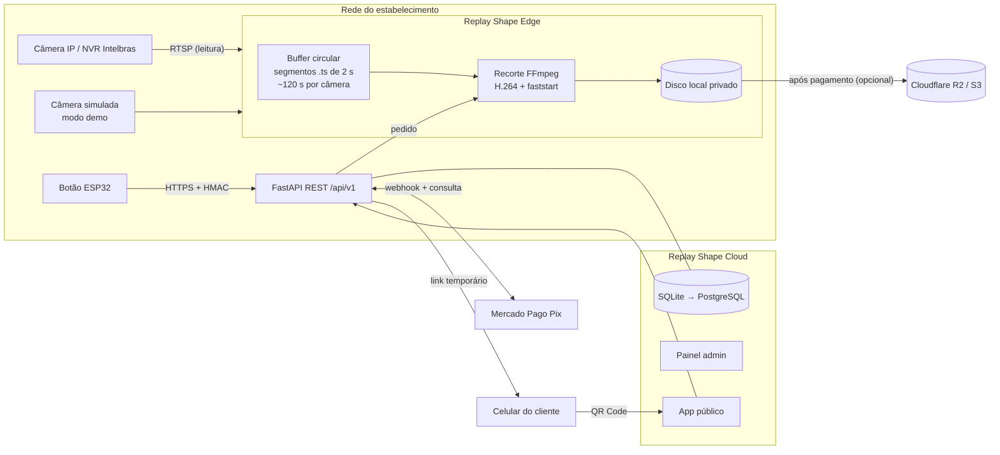
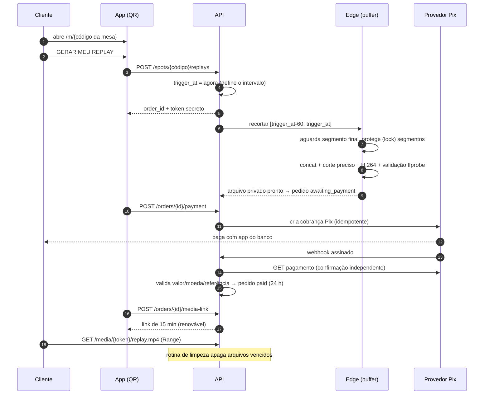
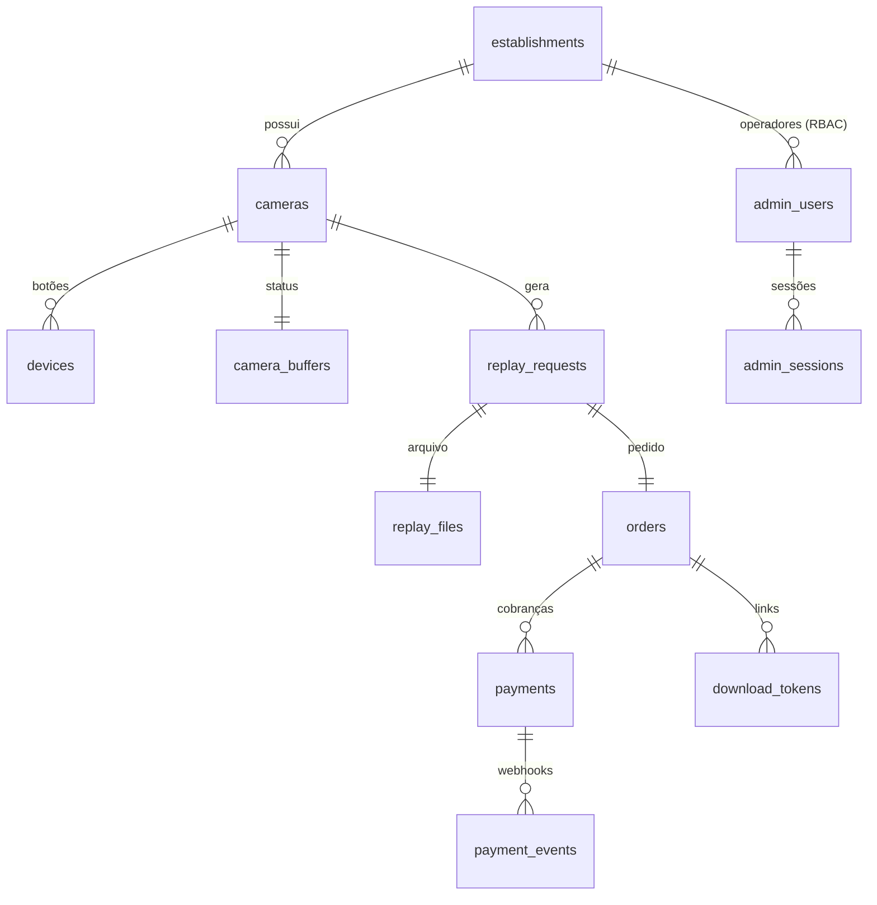

# Arquitetura

## Visão geral

No MVP, **Edge e Cloud rodam no mesmo processo** (um computador, Cenário A). As fronteiras
existem no código e permitem separar os dois depois (Cenário B/C):

- `edge/` cuida do buffer por câmera, do recorte e do disco local. Não conhece pagamentos.
- `services/orders.py` cuida de pedidos, Pix, webhooks e conciliação. Não conhece FFmpeg.
- `services/replays.py` faz a ponte entre os dois. Ao separar, ela vira uma fila: a Cloud publica a
  solicitação e o Edge busca o trabalho por conexão de **saída**. Assim, nenhuma câmera fica
  exposta à internet.

## Fluxo principal

## Estados (modelados separadamente)

| Entidade | Estados |
|---|---|
| Captura (`replay_requests`) | `queued → capturing → processing → ready \| failed` |
| Pedido (`orders`) | `processing → awaiting_payment → paid → closed`; `failed`, `expired`, `paid_unfulfillable`, `refund_pending`, `refunded` |
| Pagamento (`payments`) | `pending → approved \| rejected \| cancelled \| expired`; `refunded`, `charged_back` |
| Arquivo (`replay_files`) | `private → available → deleted`; `missing`; remoto `none/pending/uploaded/failed/deleted` |

Regras de consistência:

- Só é possível criar cobrança com o pedido em `awaiting_payment`, ou seja, com o arquivo gerado e
  validado. **Falha na geração nunca gera cobrança.**
- As transições de pagamento acontecem em transações `BEGIN IMMEDIATE`, o que serializa webhooks
  concorrentes.
- Pagamento aprovado com o pedido já pago é tratado como duplicado e estornado.
- Pagamento aprovado depois de o arquivo sumir leva a `paid_unfulfillable` e ao estorno.
- Pagamento aprovado depois do prazo, com o arquivo ainda na tolerância, libera normalmente.

## Modelo de dados

Também há as tabelas `audit_logs`, `system_settings`, `privacy_requests` e `mock_pix_charges`
(esta última é o provedor simulado). Esquema completo em `database/migrations/001_initial.sql`.
Os campos de data são epoch UTC. O SQL é portável para PostgreSQL com ajustes mínimos de tipos.

## Buffer circular (Estratégia A)

- Um processo FFmpeg por câmera grava segmentos MPEG-TS de 2 s. A lista CSV do muxer `segment`
  informa o início e o fim de cada segmento no tempo do stream.
- **Conversão para horário de parede**: `âncora = min(observado − fim_relativo)` numa janela
  deslizante de 30 segmentos. Como o registro só aparece depois que o segmento termina, o mínimo
  converge para o menor atraso real. A precisão medida nos testes está em
  [docs/TEST_REPORT.md](docs/TEST_REPORT.md).
- Segmentos com mais de `buffer_seconds` são apagados. Os segmentos em uso por um recorte ficam com
  *lock* e não são apagados.
- Um *watchdog* reinicia o FFmpeg quando ele morre ou para de produzir segmentos, com *backoff*
  exponencial de até 30 s. O status da câmera é atualizado (`online/offline/error`).
- Câmeras RTSP reais usam `-c copy`, sem recodificar, o que custa pouca CPU. O recorte final
  recodifica para H.264 e garante corte preciso e compatibilidade.

## Estratégia B (gravação histórica no NVR)

`IntelbrasAdapter.playback_url()` gera a URL `/cam/playback?...starttime=...&endtime=...`, mas
ela só é usada se o administrador marcar **"Playback histórico validado"** na câmera depois de
testar no equipamento. A compatibilidade **não** é presumida. Veja [docs/INTELBRAS.md](docs/INTELBRAS.md).

## Decisões técnicas

| Decisão | Motivo |
|---|---|
| FastAPI + SQLite + FFmpeg, sem ORM | Menos dependências. As consultas são parametrizadas, e as migrações são SQL puro. |
| Frontend sem framework | Carrega rápido no 4G e funciona com CSP restrita, sem scripts inline. |
| Recorte recodificado por padrão | Precisão de quadro. O modo `fast_copy` fica disponível para máquinas fracas. |
| Upload remoto só depois do pagamento | Economiza upload e armazenamento. O replay não pago nunca sai da rede local. |
| Token secreto por pedido + links de 15 min | Evita IDOR e não existe galeria pública. |
| Assinatura SigV4 própria (sem boto3) | Mantém a imagem pequena. Está validada pelo vetor oficial da AWS. |
| Provedor Pix simulado com tabela própria | A demo usa o mesmo caminho do provedor real: webhook assinado, consulta e validação. |
