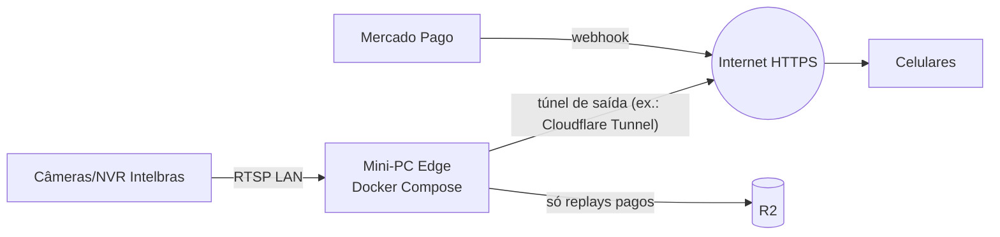

# Implantação

> As estimativas de hardware abaixo são **estimativas de projeto**, não benchmarks medidos. O único
> dado medido neste repositório é o tempo de processamento da demo: ~3,9–5,3 s por replay em um
> i7-8750H, com câmera sintética 720p (ver [docs/TEST_REPORT.md](docs/TEST_REPORT.md)).

## Cenário A — prova de conceito local (prioridade atual)

- Computador existente (Windows, Linux ou macOS), Python 3.11+ e FFmpeg, ou Docker.
- Uma câmera (ou a simulada), SQLite, disco local, pagamento simulado.
- Comandos no [README](README.md). Para testar no celular na mesma rede Wi-Fi, use
  `--host 0.0.0.0` e defina `RS_PUBLIC_BASE_URL=http://IP-DO-PC:8000`, para que os QR Codes apontem
  para o PC.

## Cenário B — MVP comercial (um estabelecimento)

- **Mini-PC** no estabelecimento rodando Edge + Cloud (`docker compose up -d`), exposto apenas por
  túnel de saída. Nenhuma porta do roteador é aberta e as câmeras continuam isoladas.
- `RS_ENV=production`, `RS_DEMO_MODE=false`, `RS_PAYMENT_PROVIDER=mercadopago`,
  `RS_COOKIE_SECURE=true`, `RS_SECRET_KEY` e o admin inicial definidos.
- O backup do volume `replay-data` deve incluir o banco SQLite e `secret.key`. **Sem a chave, as
  senhas de câmera cifradas ficam ilegíveis.**
- Monitoramento básico: `/api/v1/health` em um *uptime checker* gratuito e o painel (câmeras
  offline, disco).

Requisitos estimados para 4–8 câmeras:

| Recurso | Estimativa | Observação |
|---|---|---|
| CPU | 4 núcleos x86 (ex.: Intel N100/i5 de geração recente) | O buffer RTSP usa `-c copy` (CPU baixa). O custo de CPU está no recorte (60 s de H.264 `veryfast` por replay). |
| RAM | 4–8 GB | |
| Disco | SSD de 128 GB+ | Buffer: ~120 s × bitrate da câmera por câmera (ex.: 4 Mbps ≈ 60 MB por câmera). Replays: ~11 MB cada. |
| Rede local | Cabeada até o NVR/câmeras | Atenção ao limite de conexões RTSP simultâneas do equipamento. |
| Upload | 5–10 Mbps | Usado só para servir replays pagos e fazer upload para o R2. |

## Cenário C — SaaS escalável

- **Edge distribuído**: um agente por estabelecimento, que **inicia conexões de saída** autenticadas
  para a Cloud e busca trabalhos de recorte em uma fila.
- **Cloud central**: FastAPI horizontal, **PostgreSQL** (migrar `database/migrations`), fila
  (Redis/RQ ou SQS), object storage (R2), logs e métricas centralizados (Prometheus/Grafana ou
  serviço gerenciado), segregação por `establishment_id` (o RBAC já existe).
- Os pagamentos ficam centralizados, com split ou repasse por estabelecimento (a preparar).

## Checklist de produção

- [ ] HTTPS com certificado válido. Proxy repassando `X-Forwarded-For` (uvicorn `--proxy-headers`).
- [ ] `.env` de produção conferido. O app recusa iniciar com configuração insegura.
- [ ] Mercado Pago em produção somente depois de validar o sandbox ([docs/MERCADOPAGO.md](docs/MERCADOPAGO.md)).
- [ ] Câmeras validadas ([docs/INTELBRAS.md](docs/INTELBRAS.md)) e QR Codes impressos com o domínio público.
- [ ] Textos de privacidade aprovados pelo jurídico ([SECURITY.md](SECURITY.md)).
- [ ] Backup diário do volume de dados.
- [ ] Senha inicial do admin trocada.

> O GitHub Pages / Cloudflare Pages servem **apenas** a demo estática. O backend precisa rodar em um
> servidor ou mini-PC.
